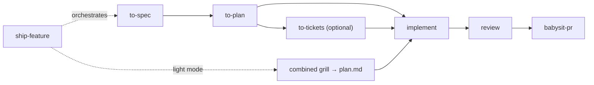

# Agentic

Composable, spec-driven development workflows for AI coding assistants (Claude Code, Cursor, Codex). Short intent-level prompts, each step configurable per harness with its own model and effort, every run auditable from a single work-item folder.

> **Use at your own risk.** Personal project exploring AI-driven development. No guarantees, no support, no liability assumed.

## Install

The repo is a plugin named `agentic`, so skills are exposed as `/agentic:to-spec`, `/agentic:ship-feature`, etc.

**Claude Code**

```bash
/plugin marketplace add JohannWilfridCalixte/agent-skills
/plugin install agentic@agentic
```

**Cursor**

```bash
git clone https://github.com/JohannWilfridCalixte/agent-skills.git ~/.cursor/plugins/local/agentic
```

**Codex**

```bash
codex plugin marketplace add JohannWilfridCalixte/agent-skills
codex plugin add agentic@agentic
```

**Single skill** (any harness supported by [`skills`](https://github.com/vercel-labs/skills))

```bash
npx skills add JohannWilfridCalixte/agent-skills --skill typescript-engineer
```

Workflow skills depend on `use-workflow` and `use-knowledge`; install those alongside.

## Feature pipeline

Each workflow runs standalone or chained by `ship-feature`. Interactive steps (capture, grill, gate, triage) run in your session; everything else runs as subagents.



- **Full mode**: spec → plan → (tickets) → implement → review → babysit PR.
- **Light mode**: one short combined grill → single `plan.md` → implement. `ship-feature` proposes light or full after triage; override with `--light` / `--full`. Bugs start with a failing regression test. Review and babysit are never skipped.
- **Escalation gate** at the end of every grill: structural decisions are confirmed (ADR `Accepted`), escalated (ADR `Proposed` / RFC, pipeline waits), or revisited.

## Skills

| Skill | Kind | Role |
|---|---|---|
| `ship-feature` | orchestrator | Chains the pipeline, triages light/full, resumable by slug |
| `to-spec` | workflow | Capture → context → product/functional grill → gate → `spec.md` |
| `to-plan` | workflow | Tech context → tech grill → gate → promote to `docs/` → `plan.md` |
| `to-tickets` | optional | Idempotent one-way push of spec + plan tasks to any tracker |
| `implement` | workflow | One subagent per task, tests first, one commit per task |
| `review` | workflow | 6 parallel lenses (spec, codestyle, tests, security, access-control, secrets) → fix loop. PR mode comments instead |
| `babysit-pr` | workflow | Push, open PR, watch CI + comments, fix, loop until merge-ready. Never merges |
| `grill` | building block | One question at a time, with a recommended answer |
| `use-workflow` | primitive | Config, step model/effort resolution, delegation, work item, audit log, resume |
| `use-knowledge` | primitive | Read and promote project knowledge in `docs/` |
| `typescript-engineer` | codestyle | TypeScript type safety, error handling, patterns |
| `python-engineer` | codestyle | Python 3.12+ typing, error handling, patterns |
| `clean-architecture` | codestyle | Ports & adapters, domain model, dependency rule |
| `code-testing` | codestyle | Test philosophy, pyramid, anti-patterns |
| `write-instrumented-code` | codestyle | Logging, tracing, OpenTelemetry |

## Configuration

Optional. `.agentic.json` at project root, then `~/.agentic/config.json` (project wins; `steps` and `limits` merged per key).

```json
{
  "output": ".agentic/work",
  "commitWork": false,
  "profiles": [
    { "name": "typescript", "detect": ["tsconfig.json"], "skills": ["typescript-engineer", "clean-architecture"] }
  ],
  "selectedProfiles": ["typescript"],
  "steps": {
    "cursor": {
      "grill": { "model": "claude-opus-5-5", "effort": "high" },
      "implement": { "model": "composer-2.5" },
      "review": { "model": "composer-2.5" },
      "review.security": { "model": "claude-opus-5-5", "effort": "high" }
    },
    "claude": { "implement": { "model": "sonnet", "effort": "medium" } },
    "codex": { "implement": { "model": "gpt-5.6", "effort": "medium" } }
  },
  "limits": { "review.iterations": 3, "babysit.rounds": 5, "implement.retries": 2 }
}
```

`steps` is a flat map per harness. A key like `review.security` falls back to its parent (`review`), then to the built-in default, then to the harness default. The full list of step keys and built-in defaults lives in [`use-workflow`](skills/use-workflow/SKILL.md). Config for interactive steps (`triage`, `grill`) is a recommendation: you get a warning if your session runs a different model.

## Work items and audit

Every feature gets one folder, shared by all workflows across sessions:

```
.agentic/work/{YYYYMMDD}-{slug}/
├── events.jsonl      # append-only audit log (source of truth)
├── state.json        # snapshot, used to resume
├── input.md
├── context.md
├── decisions.md
├── spec.md           # full mode only
├── plan.md
├── implementation.md
├── reviews/{iteration}-{lens}.md
└── pr.md
```

Follow a run live from another terminal:

```bash
tail -f .agentic/work/*/events.jsonl
```

Pass a slug to any workflow to resume it. Add the work folder to `.gitignore` unless you set `commitWork: true`:

```gitignore
.agentic/work
```

## Breaking changes in v2

v2 is a clean break from v1:

- No personas: `agents/` is gone.
- No `agentic-cli`.
- Skill names are plain (`typescript-engineer`, not `agentic:skill:typescript-engineer`); the `/agentic:` prefix now comes from the plugin.
- Old config keys (`namespace`, `ides`, `*ModelName`, `outputFolder`) are gone; use `steps`, `limits`, `output`.
- Removed skills: `use-agentic`, `delegate-work` (merged into `use-workflow`), `technical-planning`, `debug`, `pr-review`, `review-loop`, `review-code`, `review-tests`, `review-security`.

Rationale and full design: [ADR-0001](docs/tech/adr/0001-prompt-library-rework.md).

## License

MIT
