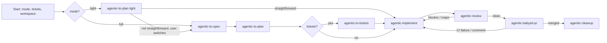
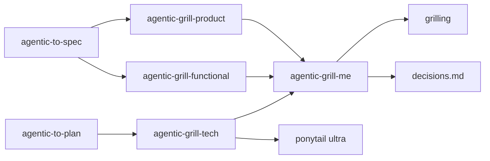

# Agentic

A software factory for Claude Code, Cursor and Codex. You describe a feature; agentic takes it through grill, spec, plan, implement, review, PR babysitting and cleanup, and stops short of merging.

- **Playbooks, end to end.** One command takes you from an idea or a bug report to a merge-ready PR. It is interactive until the last gate and autonomous after it.
- **Best-in-class skills, composed.** Proven third-party skills (Matt Pocock, Cloudflare, Anthropic and others) are vendored verbatim. Thin agentic wrappers add the work item, model routing, gates and loops.
- **Auditable and resumable.** Every run lives in one work item folder with an append-only event log. Re-run with the slug and it picks up where it stopped.

Docs site: <https://johannwilfridcalixte.github.io/agent-skills/>

> [!NOTE]
> Agentic is built for frontier models to do the heavy thinking (grilling, spec, plan, security review), so implementation can then go to smaller, cheaper models. Choose models per step in [config](docs/configuration.md#steps) (`steps.<harness>.<step>`).

> **Use at your own risk.** This is a personal project exploring AI-driven development. No guarantees, no support, no liability assumed.

## Contents

- [Install](#install)
  - [Fastest path](#fastest-path)
  - [Prerequisites](#prerequisites)
  - [Alternatives](#alternatives)
  - [Update](#update)
- [Use](#use)
  - [First 5 minutes](#first-5-minutes)
  - [Playbooks](#playbooks)
  - [Light vs full mode](#light-vs-full-mode)
  - [What you're asked vs what runs alone](#what-youre-asked-vs-what-runs-alone)
  - [Resume](#resume)
  - [Where outputs land](#where-outputs-land)
- [How it works](#how-it-works)
  - [Composition](#composition)
  - [A playbook, end to end](#a-playbook-end-to-end)
  - [Grilling](#grilling)
  - [Work item, state, audit log](#work-item-state-audit-log)
  - [Gates and escalations](#gates-and-escalations)
  - [Implement and review loops](#implement-and-review-loops)
  - [Configuration](#configuration)
  - [Vendored skills](#vendored-skills)
  - [Decisions (ADRs)](#decisions-adrs)
- [Customise](#customise)
- [Reference](#reference)
- [Credits](#credits)
- [License](#license)

## Install

### Fastest path

Pick your harness and run one command.

| Harness | Install | Then run |
|---|---|---|
| Claude Code | `/plugin marketplace add JohannWilfridCalixte/agent-skills` then `/plugin install agentic@agentic` | `/agentic:agentic-implement-feature` |
| Codex | `codex plugin marketplace add JohannWilfridCalixte/agent-skills` then `codex plugin add agentic@agentic` | `$agentic-implement-feature` |
| Cursor | `git clone https://github.com/JohannWilfridCalixte/agent-skills.git ~/.cursor/plugins/local/agentic`, then **Developer: Reload Window** | `/agentic-implement-feature` |
| Any (skills CLI) | `npx skills add JohannWilfridCalixte/agent-skills` | `/agentic-implement-feature` (`$…` in Codex) |

Notes:

- **Names.** Agentic skills are named `agentic-<name>`; vendored skills keep their upstream names. The Claude Code plugin namespaces skills as `agentic:<name>`.
- **Cursor.** It needs a real clone, because symlinks that point outside the plugins folder are ignored. For teams: Dashboard → Plugins & MCPs → Add Marketplace → Import from Repo.
- **Codex** reads `.agents/plugins/marketplace.json` and `.codex-plugin/plugin.json`. `codex plugin marketplace add` also accepts a local path, a git URL or `--ref <ref>`.
- **Blocked plugins.** Admins can block plugin imports. If yours do, use the skills CLI or a [local clone](#local-clone).

Optional next step: `/agentic-configure` (`$agentic-configure` in Codex) detects your harnesses and their models, then writes a config. Without one, built-in defaults apply.

### Prerequisites

| Tool | Needed for |
|---|---|
| Claude Code, Cursor or Codex | Running the skills |
| `git` | Worktrees, commits, cleanup |
| `gh`, or a Bitbucket/GitLab CLI or MCP | `agentic-babysit-pr`, `agentic-pr-review`, `agentic-cleanup`, and publishing audit issues to GitHub |
| `node` / `npx` (or `bunx`, `pnpx`, `pnpm dlx`) | The skills CLI install path; the vendoring script |
| `jq` (optional) | [Following a run live](#work-item-state-audit-log) |
| `gitleaks` or `trufflehog` (optional) | `agentic-review-secrets`. Without either, it falls back to a manual pass and says so |

Nothing else needs installing: third-party skills are vendored in the repo.

### Alternatives

#### skills CLI, with options

[`skills`](https://www.npmjs.com/package/skills) runs through `npx`, `bunx`, `pnpx` or `pnpm dlx`.

```bash
npx skills add JohannWilfridCalixte/agent-skills          # or: bunx skills add … / pnpx skills add … / pnpm dlx skills add …
npx skills add JohannWilfridCalixte/agent-skills -l       # list skills, install nothing
npx skills add JohannWilfridCalixte/agent-skills -g -a claude-code -a codex -s agentic-implement-feature -y
```

| Flag | Effect |
|---|---|
| `-g` | Install at user level (every project) instead of the current project |
| `-a <agent>` | Target harness: `claude-code`, `cursor`, `codex`, … (repeatable, `'*'` = all) |
| `-s <name>` | Install one skill (repeatable, `'*'` = all) |
| `-l` | List available skills only |
| `-y` | No prompts |
| `--copy` | Copy into each harness folder. By default there is one copy in `.agents/skills/<name>`, symlinked from the harness folders (e.g. `.claude/skills`) |

Skills land flat (`<skills-dir>/<name>/`), and their hashes go to `skills-lock.json`. Manage them with `npx skills list` and `npx skills remove`.

#### Local clone

Symlink each skill folder into `~/.agents/skills` (Cursor, Codex) and/or `~/.claude/skills` (Claude Code).

```bash
git clone https://github.com/JohannWilfridCalixte/agent-skills.git ~/development/agent-skills
mkdir -p ~/.agents/skills ~/.claude/skills
for d in ~/development/agent-skills/skills/*/*/; do
  ln -s "${d%/}" ~/.agents/skills/
  ln -s "${d%/}" ~/.claude/skills/
done
```

### Update

| Install | Update |
|---|---|
| Claude Code plugin | `/plugin marketplace update agentic` |
| Codex plugin | `codex plugin marketplace upgrade` |
| Cursor clone, local clone | `git pull` |
| skills CLI | `npx skills update [-g\|-p] [-y]`. This re-installs only skills whose content changed, as symlinks even if they were first added with `--copy` |

## Use

### First 5 minutes

1. Open a repo with a green build, then run:

   ```text
   /agentic-implement-feature light add a --version flag to the CLI
   ```

   Use `/agentic:agentic-implement-feature …` with the Claude Code plugin, or `$agentic-implement-feature …` in Codex.

2. Answer the start questions, asked in one exchange:
   - **Workspace**: a new worktree (`feat/{slug}`, recommended), the current branch, or another branch.
   - Whether to copy untracked files such as `.env` into the worktree.
3. Light mode reads the code and checks the feature really is small. It then asks every blocking question in one go and writes `plan.md`.
4. From here the run is autonomous. It gives you the resume command once, then:
   - implements one commit per task, with a green gate after each;
   - runs the reviewers and loops until no blocker or major is left;
   - pushes, opens a PR and watches CI and comments;
   - reports when the PR is merge-ready.
5. You merge. The skill sees the merge, then cleans up the worktree and branches and archives the work item.

You can watch it happen with `tail -f` on the [event log](#work-item-state-audit-log), or read `.agentic/work/{YYYYMMDD}-{slug}/`.

### Playbooks

Playbooks are user-invoked: the model never starts them on its own.

| Playbook | Pick it when | Example |
|---|---|---|
| `agentic-implement-feature` | Building something new | `/agentic-implement-feature add CSV export to reports` |
| `agentic-change-feature` | Changing existing behaviour. Spec and plan record current vs target behaviour | `/agentic-change-feature light make session timeout 30 min` |
| `agentic-debug` | Fixing a bug: diagnose first, then a regression test, then the fix | `/agentic-debug PROJ-123` |
| `agentic-pr-review` | Reviewing a PR once, with no fixes. Output is a local report or one posted review | `/agentic-pr-review 42` |
| `agentic-security-audit` | Running a whole-repo or path-scoped security audit that files issues, with no fixes | `/agentic-security-audit src/api` |
| `agentic-configure` | Writing your config: models, reviewers, folders, profiles, limits | `/agentic-configure --project` |

Arguments:

| Skill | Arguments |
|---|---|
| `agentic-implement-feature`, `agentic-change-feature` | `[light] <text \| file \| ticket key \| URL \| slug>` |
| `agentic-debug` | `<bug report \| file \| ticket key \| URL \| slug>` |
| `agentic-pr-review` | `[<PR number \| URL>]`. With none, it uses the current branch's PR |
| `agentic-security-audit` | `[<paths> \| <slug>]` |
| `agentic-configure` | `[--global \| --project]` |

Per harness:

- **Claude Code / Cursor**: `/agentic-…`. With the Claude Code plugin: `/agentic:agentic-…`.
- **Codex**: `$agentic-…`. Playbooks and `agentic-configure` set `policy.allow_implicit_invocation: false` in `agents/openai.yaml`.

#### Playbook details

- **`agentic-change-feature`** is a thin alias of `agentic-implement-feature` with branch `change`. Spec and plan start from the current behaviour.
- **`agentic-debug`**:
  - Start asks only about the workspace (`fix/{slug}`).
  - `diagnosing-bugs` Phases 1–4 run interactively, with loop files in `{work}/debug/`, and produce `diagnosis.md`: symptom, red loop, repro, root cause (`file:line`), ruled-out hypotheses and seam.
  - If there is no good seam, you choose the closest seam, or to stop or deepen (`codebase-design`).
  - Then come the to-plan light bug rules: T1 is a failing regression test, followed by one approval round. The autonomous tail follows, and the merge-ready report includes the root cause.
- **`agentic-pr-review`**:
  - Reviews the given PR, or the current branch's PR.
  - Output is a local `reviews/pr-report.md` or one posted PR review.
  - Verdict: any blocker → request changes; any major or needs-user finding → comment; otherwise → approve.
  - Security findings go through the [disclosure guard](skills/core/agentic-use-workflow/references/disclosure.md) before anything is posted.
- **`agentic-security-audit`**:
  - Start asks for scope, profile (`quick`, `standard` or `deep`), output dir and destination. The output dir defaults to `{output}/{work}/audit/run-{N}/`, needs explicit confirmation, and gets an ignore check with an offer to add it to `.git/info/exclude`. Destinations: local, `github:owner/repo`, `jira:KEY`, `linear:TEAM`, or other.
  - The audit then runs in the current checkout: `context.docs`, then a full `security-audit` audit (its agents use the `audit` model), then a report summary (verdict counts, severities, top findings, coverage).
  - Next you choose to publish or stop. Publishing goes through the disclosure guard and creates a parent issue plus one child per confirmed finding ([issues.md](skills/playbooks/agentic-security-audit/references/issues.md)).
  - No fixes. A re-run is a new pass. To fix: `/agentic-change-feature <parent ref | path to issues/index.md>`, which runs full mode with tickets.
- **`agentic-configure`**:
  - Detects harnesses: `agent`/`cursor-agent`, `claude`, `codex` on PATH, or `~/.cursor`, `~/.claude`, `~/.codex`.
  - Walks through reviewers (offering to install new ones), then the model table (from `agent models`, `codex debug models`, Claude aliases), folders, profiles and limits.
  - Writes only what differs from the defaults, and only after a yes, then validates. Models go in global config, everything else in project config.
  - Opens no work item.

### Light vs full mode

| | Full (default) | Light |
|---|---|---|
| Invoke | `/agentic-implement-feature <input>` | `/agentic-implement-feature light <input>`, or pick light at start |
| Steps | grill product + functional → `spec.md` → grill tech → `plan.md` → tickets? | code read → straightforward check → one exchange of blocking questions → `plan.md` with its own ACs |
| Approvals | spec gate, plan gate, escalation gates | none |
| Tickets | optional (asked at start) | no |
| Best for | Anything with design choices | Small, obvious features |

**The light check.** A feature counts as straightforward only if all of these hold:

- 5 blocking questions or fewer;
- no ADR-worthy decision;
- no data migration or public contract change;
- no new domain term;
- about 5 tasks or fewer.

If it isn't straightforward, light mode says why and offers full mode; it never switches silently. Saying no stops the run and prints the resume command.

`agentic-change-feature light` uses the same check. Its ACs show `(was: …)`, and T1 pins any kept behaviour that tests don't cover yet. See [ADR-0003](docs/tech/adr/0003-implement-feature-light-mode.md) and [light.md](skills/flow/agentic-to-plan/references/light.md).

### What you're asked vs what runs alone

| You're asked | Runs autonomously |
|---|---|
| Start: workspace, mode, tickets, untracked-file copy (only what you haven't already answered) | Context gathering by read-only subagents |
| Grill questions (product, functional, tech), each with a recommended answer | `implement`: one subagent and one conventional commit per unit, with a green gate (build, lint, typecheck, tests) after each |
| Spec and plan approval (full mode) | `review`: every reviewer, dedupe, fix list, re-review |
| Escalation gate: confirm / escalate / revisit each structural decision | `babysit-pr`: push, open the PR, poll CI and comments, fix |
| Interrupts after the last gate: a limit hit, a design-level PR comment, an unfixable red tree, a new escalation, a PR closed unmerged | `cleanup` after merge |

Hard rules:

- It never merges.
- It force-pushes only after a yes.
- The implement baseline must be green before work starts.

### Resume

After a usage limit, a crash or a closed session, re-run the same playbook with the work item slug. This works from any harness on the same machine.

```text
/agentic-implement-feature 20261101-csv-export      # Claude Code, Cursor
$agentic-implement-feature 20261101-csv-export      # Codex
```

On resume, it:

- resolves open escalations first (decided, override or stop);
- asks you to confirm when another session still looks active;
- reuses the recorded workspace and earlier answers;
- finishes any unfinished fix list, and skips steps that are already done;
- for a unit cut off mid-edit, asks whether to finish it or stash it, and never discards work.

An abrupt stop loses at most the units that were in flight.

It works on the same machine only: work items live in the gitignored `output` folder, and workspace paths are absolute. Pass a slug to any flow skill to resume it.

### Where outputs land

Each run gets one work item folder, `.agentic/work/{YYYYMMDD}-{slug}/`, which stays in the main checkout even when the code is built in a worktree. Code goes to the workspace branch and the PR. Decisions promoted at gates are committed to the knowledge base (`knowledge.root`, default `docs/`). See [Work item, state, audit log](#work-item-state-audit-log).

## How it works

### Composition

Agentic is pure composition. Third-party skills, vendored verbatim, do the craft: grilling, spec, tickets, TDD, code review, diagnosis, security audit. Agentic skills are thin wrappers beside them that add the work item, config, model routing, subagent delegation, gates, project knowledge, the audit log and loops. Playbooks chain flow skills. Reviewers and codestyle are swapped in config. See [ADR-0002](docs/tech/adr/0002-skill-composition.md).

```text
skills/
  core/        runtime: agentic-use-workflow, agentic-use-knowledge, agentic-configure
  codestyle/   rulesets: typescript, python, clean architecture, instrumentation, testing
  flow/        agentic steps playbooks call (agentic-grill-me, agentic-to-spec, …)
               + vendored grilling, to-spec, to-tickets, implement, tdd, codebase-design, diagnosing-bugs, ponytail
  review/      agentic-review (review step, finding contract) + reviewers: vendored code-review, ub-mode,
               super-review, pr-security-review; claude-security-review (wraps a vendored prompt),
               agentic-review-secrets, agentic-review-access-control; vendored security-audit (full audits)
  playbooks/   user-invoked end-to-end chains
```

How skills reference each other:

- **Placement.** A wrapper sits next to the copy it wraps.
- **User-invoked copies** (`to-spec`, `to-tickets`, `implement`) are read by relative path (`../implement/SKILL.md`). Model-invoked ones are called through the Skill tool.
- **Links stay local.** Relative links never leave their group folder, so they resolve both nested (clone, plugin) and flat (`npx skills`).
- **Codex and Cursor** have no Skill tool, so they open the `SKILL.md` path instead.

### A playbook, end to end

`agentic-implement-feature`:



Everything up to the last gate is interactive. The tail (implement → review → babysit-pr → log `completed` → cleanup) is autonomous. The full contract is in [playbook.md](skills/core/agentic-use-workflow/references/playbook.md).

### Grilling

Grilling happens inside `agentic-to-spec` and `agentic-to-plan`:



Every answer is logged to `decisions.md`, as entries like `## D3 · structural · tech` with Q / A / Why / Supersedes. Tags are `structural` or `minor`; the origin is `recommended`, `alternative` or `deferred`.

Every focus recommends the leanest complete option, by asking in order: is it needed at all? Is it already in the codebase? Does the stdlib or platform cover it? Does an installed dependency? What is the minimum new work? Some things are never cut: validation at trust boundaries, error handling that prevents data loss, security, accessibility, and anything you asked for. Tech grilling also loads `ponytail` at ultra, and turns it off at handoff ([ADR-0005](docs/tech/adr/0005-ponytail-in-grills.md)).

### Work item, state, audit log

There is one folder per feature, shared by every skill across sessions:

```text
.agentic/work/{YYYYMMDD}-{slug}/
├── events.jsonl          # append-only audit log (source of truth)
├── state.json            # snapshot derived from the log, used to resume
├── input.md  context.md  decisions.md
├── spec.md  plan.md
├── diagnosis.md  debug/  # agentic-debug
├── tickets/NN-slug.md    # local tracker
├── implementation.md
├── reviews/{n}-{reviewer}.md  reviews/{n}-fix.md  reviews/pr-report.md
├── pr.md
└── audit/run-N/  audit/issues/   # agentic-security-audit

.agentic/work/_archive/{YYYYMMDD}-{slug}/   # after cleanup, never deleted
```

- **Events**: `started`, `progress`, `completed`, `failed`, `decision`, `escalation`, `artifact`, `gate`, `note`.
- **`state.json` status**: `in_progress`, `awaiting_decision`, `blocked`, `failed`, `done`, `archived`. If the log and the snapshot disagree, the log wins.
- **Git**: gitignore `.agentic/work` unless `commitWork: true`.

To follow a run live:

```bash
tail -f .agentic/work/*/events.jsonl | jq -r '"\(.ts[11:19]) \(.workflow)/\(.step)\(if .task then "/"+.task else "" end) \(.type) [\(.model // "-")] \(.summary)"'
```

Line contract: [state.md](skills/core/agentic-use-workflow/references/state.md).

### Gates and escalations

After the grills in `agentic-to-spec` and `agentic-to-plan`, each structural decision goes through a gate, where it is:

- **Confirmed**: becomes an ADR with status `Accepted`.
- **Escalated**: becomes an ADR with status `Proposed`, or an RFC. The run waits with status `awaiting_decision`.
- **Revisited**: goes back to grilling.

Confirmed knowledge is promoted by `agentic-use-knowledge`, which commits it as `docs: …` into `knowledge.root` (default `docs/`): `tech/principles.md`, `tech/adr/`, `tech/rfc/`, `product/`, `ubiquitous-language/`, `landing-zone/`. Contract: [escalation.md](skills/core/agentic-use-workflow/references/escalation.md).

ADRs are refined in place, each change a `History` row; `Superseded` only when a decision is fully retired. Outside a workflow, `agentic-use-knowledge` offers at the end of a conversation to capture what it settled.

### Implement and review loops

- **Implement.**
  - Work is split into units: the fix list first, then tickets, then plan tasks.
  - Each unit gets one subagent following matt's `implement`, and one conventional commit.
  - A green gate (build, lint, typecheck, tests) runs after each unit. A red unit is retried `implement.retries` times, then you're asked.
- **Review.**
  - One report-only subagent runs per `reviewers` entry, on the branch diff, and writes `reviews/{n}-{name}.md`.
  - Findings are deduped into a fix list, which goes to `agentic-implement`; then every reviewer re-runs.
  - Severities are `blocker`, `major`, `minor` and `nit`. Only blocker and major loop; minor and nit are reported only.
  - Needs-user findings are asked in one question (done / accepted).
  - When `review.iterations` is hit, you're asked: another round, accept, or stop. `--only <reviewer,…>` narrows the reviewers.
  - Contract: [finding.md](skills/review/agentic-review/references/finding.md).
- **Babysit.**
  - Pushes, opens the PR against base, and polls CI and comments with backoff.
  - Triages CI, bot, human and conflict items, and fixes through implement → review.
  - On merge-ready it reports and keeps watching. It returns at merge or close.
  - Never merges. Uses `gh` or a Bitbucket/GitLab CLI or MCP, and defers to native loops (Cursor `babysit`, Claude Code `/loop`).
- **Cleanup** (`[<slug> | --all]`).
  - Removes the worktree and the local and remote branches, fast-forwards the default branch, and archives the work item.
  - Asks first if the PR was closed unmerged or work is unpushed.

Default reviewers:

| Reviewer | Looks at |
|---|---|
| `code-review` | General code review (Matt Pocock) |
| `ub-mode` | Make it work, then make it right: TDD, root causes, complexity and duplication gates (Uncle Bob) |
| `claude-security-review` | Anthropic's security-review prompt on the diff |
| `super-review` | PR readiness: own hypotheses first, file:line proof, adversarial truth-check (super-board) |
| `agentic-review-secrets` | Credential leaks |
| `agentic-review-access-control` | Authz, IDOR, tenant isolation |

`pr-security-review` is vendored but opt-in ([ADR-0004](docs/tech/adr/0004-security-audit-and-review.md)).

### Configuration

Configuration is optional. Two files are read:

- `.agentic.json` (project), which wins;
- `~/.agentic/config.json` (global).

`steps` merges per harness and key, and `limits` per key. Other keys replace.

```json
{
  "reviewers": ["code-review", "claude-security-review", "agentic-review-secrets"],
  "steps": {
    "claude": {
      "grill": { "model": "opus", "effort": "high" },
      "implement": { "model": "sonnet", "effort": "medium" }
    }
  },
  "limits": { "review.iterations": 3 }
}
```

Defaults:

- **Output**: `.agentic/work`, not committed.
- **Worktrees**: `../{repo}-worktrees`.
- **Knowledge**: `docs`.
- **Profiles**: `typescript`, `python`.
- **Models**: frontier for grill, security reviews and audit; code for implement and review; fast for tickets.

Full reference (fields, profiles, step keys, routing, resolution, limits, harness notes): [docs/configuration.md](docs/configuration.md).

### Vendored skills

Vendored skills are copied byte-identical from upstream, together with its `LICENSE` when one exists. They are listed in [`vendor.json`](vendor.json) and pinned in [`vendor.lock.json`](vendor.lock.json): a commit SHA (`ref`) plus the `npx skills` `computedHash` for each skill, using the same schema as `skills-lock.json`.

| Skill | Source | Licence | Folder |
|---|---|---|---|
| `grilling` | `mattpocock/skills` | MIT | `skills/flow` |
| `to-spec` | `mattpocock/skills` | MIT | `skills/flow` |
| `to-tickets` | `mattpocock/skills` | MIT | `skills/flow` |
| `implement` | `mattpocock/skills` | MIT | `skills/flow` |
| `tdd` | `mattpocock/skills` | MIT | `skills/flow` |
| `diagnosing-bugs` | `mattpocock/skills` | MIT | `skills/flow` |
| `codebase-design` | `mattpocock/skills` (called by `tdd`) | MIT | `skills/flow` |
| `ponytail` | `DietrichGebert/ponytail` (loaded by `agentic-grill-tech`) | MIT | `skills/flow` |
| `code-review` | `mattpocock/skills` | MIT | `skills/review` |
| `super-review` | `EricTechPro/super-board` | MIT | `skills/review` |
| `pr-security-review` | `EricTechPro/super-board` | MIT | `skills/review` |
| `security-audit` | `cloudflare/security-audit-skill` | MIT | `skills/review` |
| `security-review.md` (prompt, wrapped by `claude-security-review`) | `anthropics/claude-code-security-review` | MIT | `skills/review/claude-security-review/upstream` |
| `ub-mode` | `unclebob/ub-mode` | none upstream: private use only | `skills/review` |

Maintenance (check, update, add, remove): [Vendoring script](#vendoring-script).

### Decisions (ADRs)

| ADR | Topic |
|---|---|
| [0001](docs/tech/adr/0001-prompt-library-rework.md) | Prompt library rework (v2, partially superseded) |
| [0002](docs/tech/adr/0002-skill-composition.md) | Skill composition (v3) |
| [0003](docs/tech/adr/0003-implement-feature-light-mode.md) | Implement-feature light mode |
| [0004](docs/tech/adr/0004-security-audit-and-review.md) | Security audit and review |
| [0005](docs/tech/adr/0005-ponytail-in-grills.md) | Ponytail in grills |
| [0006](docs/tech/adr/0006-cross-harness-steps.md) | Cross-harness steps |

Index: [docs/tech/adr/README.md](docs/tech/adr/README.md).

## Customise

### Swap reviewers

`reviewers` is a list of model-invoked skill names. Any available review skill works: vendored, installed with `npx skills add <source> --skill <name>`, or your own. Add the names you want and drop the ones you don't. Each one runs report-only in its own subagent on the branch diff and writes `reviews/{n}-{name}.md`. Tune its model with `steps.<harness>.review.<name>`, or run it on another harness's CLI with its `harness` field (e.g. `super-review` through `codex exec` from Claude Code).

### Swap codestyle

Codestyle comes from two places:

- **Profile skills** apply to every coding step.
- **Per-task `Skills`** in `plan.md` apply to that task only.

Any installed skill name works, third-party included. Put it in a profile's `skills` to force it everywhere, or let `agentic-to-plan` assign it per task.

### Write your own playbook

A playbook is a user-invoked skill that calls flow skills in order:

```markdown
---
name: my-hotfix
description: Ship a one-line hotfix with review.
disable-model-invocation: true
---

1. Call the Skill tool with "agentic-use-workflow". Log `started` with workflow `my-hotfix`.
2. Call the Skill tool with "agentic-to-plan" and take its light branch.
3. Call the Skill tool with "agentic-implement".
4. Call the Skill tool with "agentic-review".
5. Call the Skill tool with "agentic-babysit-pr".
```

For Codex, add `agents/openai.yaml` with `policy.allow_implicit_invocation: false`. Playbooks can only call model-invoked skills. See [`skills/playbooks`](skills/playbooks) for full examples.

## Reference

### Flow skills

Agentic flow skills are all model-invoked, and each one can be used standalone.

| Skill | Role |
|---|---|
| `agentic-grill-me` | Matt's `grilling` plus project knowledge, `context.md` and `decisions.md`. Every answer is logged to `decisions.md` |
| `agentic-grill-product` / `-functional` / `-tech` | `agentic-grill-me` scoped to one focus. Every focus recommends the smallest complete option; tech also loads `ponytail` at ultra and turns it off at handoff |
| `agentic-to-spec` | capture → context → grill product + functional → gate → matt's `to-spec` → `spec.md` |
| `agentic-to-plan` | tech context → grill tech → gate → promote to knowledge → `plan.md` ([plan.md contract](skills/flow/agentic-to-plan/references/plan.md)). The light branch (debug, and light mode) has no grill or gate. Without `diagnosis.md`: straightforward check plus one exchange of blocking questions, no approval. With `diagnosis.md`: T1 is a failing regression test |
| `agentic-to-tickets` | Matt's `to-tickets` on spec + plan, local (`tickets/NN-slug.md`) or in a real tracker. When the input has child items (an audit parent), they are reused as tickets, and local ones are copied into the work item |
| `agentic-implement` | One subagent per ticket, task or fix list, following matt's `implement`, with one commit each and a green gate between |
| `agentic-review` | One subagent per `reviewers` entry, report-only, with a fix loop through `agentic-implement`. PR mode: report or post. Args: `[<slug> \| <PR number/url> \| <base ref>] [--only <reviewer,reviewer>]` |
| `agentic-babysit-pr` | Push, open the PR, watch CI and comments, and fix through implement → review until merged. Never merges |
| `agentic-cleanup` | After merge: remove the worktree and branches, update the default branch, archive the work item. Args: `[<slug> \| --all]` |

Other skills:

- **Core.**
  - `agentic-use-workflow`: config, routing, [delegation](skills/core/agentic-use-workflow/references/delegation.md), work item, events, gate, disclosure guard.
  - `agentic-use-knowledge`: reads, promotes and captures the knowledge base (`knowledge.root`).
  - `agentic-configure`: config.
- **Review** (`skills/review`).
  - `agentic-review`: the review step; owns the finding contract.
  - The vendored reviewers above.
  - `claude-security-review`: Anthropic's security-review prompt on the diff.
  - `agentic-review-secrets`: credential leaks.
  - `agentic-review-access-control`: authz, IDOR, tenant isolation.
  - `security-audit` (vendored): whole-repo audits for `agentic-security-audit`.
- **Codestyle.** `agentic-typescript-engineer`, `agentic-python-engineer`, `agentic-clean-architecture`, `agentic-write-instrumented-code`, `agentic-code-testing`.

### Vendoring script

`node scripts/vendor-skills.mjs <command>` ([source](scripts/vendor-skills.mjs)) needs `node`, `npx` and `git`.

| Task | How |
|---|---|
| Check | `check` compares each upstream default-branch HEAD with the lock, read-only. It lists changed or missing skills with a GitHub compare link, and exits 1 when a skill's content changed upstream. HEAD moving alone doesn't count |
| Update | `update [skill...]` (default: all) re-vendors at upstream HEAD and rewrites the lock. Review the diff, then commit |
| Verify | `verify` re-hashes every copy against the lock, ignoring the added `LICENSE`. It exits 1 on any edit or missing folder |
| Add one | Append `{ "source": "<owner/repo>", "skill": "<name>", "into": "skills/<group>" }` to `vendor.json` and run `update <name>`. Then add the folder to the three plugin manifests (`.claude-plugin`, `.cursor-plugin`, `.codex-plugin`) |
| Add one file | For an upstream with no skill folder, append `{ "source": "<owner/repo>", "name": "<lock key>", "file": "<path in repo>", "into": "skills/<group>/<skill>/upstream" }` and run `update <name>`. `update` wipes `into` and writes only the file plus `LICENSE`, so the wrapper `SKILL.md` lives one level up, and that is the folder the manifests list |
| Remove one | Delete its `vendor.json` entry, its folder and its manifest paths, then run `update` to prune the lock |

Caveats:

- **super-review standalone.** Invoked outside `agentic-review`, it still runs its board, PR and merge steps, and links to super-board files that aren't vendored. Use it through `agentic-review`, which maps them ([super-review.md](skills/review/agentic-review/references/super-review.md)).
- **Name collisions.** Installing the upstream skills or plugins as well (`mattpocock/skills`, `super-board`, `ub-mode`, `security-audit-skill`, `ponytail`) gives you two skills with the same name. Keep one copy per harness.

### Breaking changes in v3

- Skills are grouped under `skills/{core,codestyle,flow,review,playbooks}`, and the manifests list every folder.
- `agentic-ship-feature` became `agentic-implement-feature`. New playbooks: `agentic-change-feature`, `agentic-debug`, `agentic-pr-review`.
- Light mode triage is gone. Debug uses to-plan's light branch, and `agentic-implement-feature light` is opt-in, with a check ([ADR-0003](docs/tech/adr/0003-implement-feature-light-mode.md)).
- `agentic-grill` became `agentic-grill-product`, `-functional` and `-tech`, on top of `agentic-grill-me` (which wraps `grilling`).
- Review lenses moved to the `reviewers` config:
  - The `spec`, `codestyle`, `tests` and `security` lenses are replaced by `code-review`, `ub-mode`, `claude-security-review` and `super-review`.
  - `pr-security-review` is vendored but opt-in.
  - `secrets` and `access-control` are now skills.
- Step keys `triage`, `review.fix` and `babysit.fix` were removed, since fixes use `implement`. `review.<lens>` became `review.<reviewer>`.
- Third-party skills are vendored in the repo, so there is nothing extra to install.

Rationale: [ADR-0002](docs/tech/adr/0002-skill-composition.md) (v3), [ADR-0003](docs/tech/adr/0003-implement-feature-light-mode.md) (light mode), [ADR-0004](docs/tech/adr/0004-security-audit-and-review.md) (security audit and review), [ADR-0005](docs/tech/adr/0005-ponytail-in-grills.md) (ponytail in grills), [ADR-0001](docs/tech/adr/0001-prompt-library-rework.md) (v2).

## Credits

Agentic stands on other people's work.

### Vendored skills

| Author | Repo | Licence | What we use |
|---|---|---|---|
| Matt Pocock | [mattpocock/skills](https://github.com/mattpocock/skills) | MIT | `grilling`, `to-spec`, `to-tickets`, `implement`, `tdd`, `diagnosing-bugs`, `codebase-design`, `code-review` |
| Dietrich Gebert | [DietrichGebert/ponytail](https://github.com/DietrichGebert/ponytail) | MIT | `ponytail` (lean-code rules in tech grilling) |
| Eric Tech | [EricTechPro/super-board](https://github.com/EricTechPro/super-board) | MIT | `super-review`, `pr-security-review` |
| Cloudflare | [cloudflare/security-audit-skill](https://github.com/cloudflare/security-audit-skill) | MIT | `security-audit` |
| Anthropic | [anthropics/claude-code-security-review](https://github.com/anthropics/claude-code-security-review) | MIT | `security-review.md` prompt, wrapped by `claude-security-review` |
| Robert C. Martin (Uncle Bob) | [unclebob/ub-mode](https://github.com/unclebob/ub-mode) | none upstream: private use only | `ub-mode`. It builds on [poteto](https://github.com/poteto)'s rules and Uncle Bob's [crapper](https://github.com/unclebob/crapper), [dryer](https://github.com/unclebob/dryer) and [mutator](https://github.com/unclebob/mutator) |

### Patterns borrowed

- **The grill-with-docs composition pattern** (Matt Pocock): a skill that delegates to co-located skills and adds only its own details. Every agentic wrapper follows it ([ADR-0002](docs/tech/adr/0002-skill-composition.md)).
- **[Writing for agents](https://github.com/mattpocock/skills/blob/main/skills/productivity/writing-for-agents/SKILL.md)** (Matt Pocock): how agent-facing prompts are written. The agentic skills were reviewed against it.
- **Intent-level prompts**: short `SKILL.md` files that capture intent rather than step scripts. Inspired by Matt Pocock's skills and the aidd plugins ([ADR-0001](docs/tech/adr/0001-prompt-library-rework.md)).

### Tooling

- [`skills`](https://www.npmjs.com/package/skills) CLI: installs the skills, and is used by the vendoring script to fetch and hash the upstream copies.

## License

MIT, see [LICENSE](LICENSE). Vendored skills keep their upstream licences (see [Credits](#credits)).
