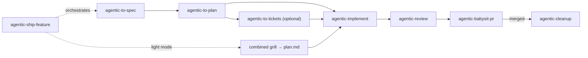

# Agentic

Composable, spec-driven development workflows for AI coding assistants (Claude Code, Cursor, Codex). Short intent-level prompts, each step configurable per harness with its own model and effort, every run auditable from a single work-item folder.

> **Use at your own risk.** Personal project exploring AI-driven development. No guarantees, no support, no liability assumed.

## Install

Every skill is named `agentic-<name>`, so the prefix shows in every harness, with or without a plugin. Invoke them as `/agentic-ship-feature` in Cursor and Claude Code, `$agentic-ship-feature` in Codex.

### Local skills (recommended)

Clone the repo and symlink each skill folder into the harness's skills directory: `~/.agents/skills` is read by Cursor and Codex (Codex follows symlinks), `~/.claude/skills` by Claude Code.

```bash
git clone https://github.com/JohannWilfridCalixte/agent-skills.git ~/development/agent-skills

mkdir -p ~/.agents/skills
for d in ~/development/agent-skills/skills/*/; do ln -s "${d%/}" ~/.agents/skills/; done

mkdir -p ~/.claude/skills
for d in ~/development/agent-skills/skills/*/; do ln -s "${d%/}" ~/.claude/skills/; done
```

A `git pull` in the clone updates every harness at once.

### Plugin

Plugins add nothing but distribution; skill names are the same. Team admins can block plugin imports, in which case use local skills.

**Claude Code** (skills show as `/agentic:agentic-ship-feature`)

```bash
/plugin marketplace add JohannWilfridCalixte/agent-skills
/plugin install agentic@agentic
```

**Cursor** (clone directly: `~/.cursor/plugins/local` ignores symlinks pointing outside it)

```bash
git clone https://github.com/JohannWilfridCalixte/agent-skills.git ~/.cursor/plugins/local/agentic
```

**Codex**

```bash
codex plugin marketplace add JohannWilfridCalixte/agent-skills
codex plugin add agentic@agentic
```

### Single skill

Any harness supported by [`skills`](https://github.com/vercel-labs/skills):

```bash
npx skills add JohannWilfridCalixte/agent-skills --skill agentic-typescript-engineer
```

Workflow skills depend on `agentic-use-workflow` and `agentic-use-knowledge`; install those alongside.

## Feature pipeline

Each workflow runs standalone or chained by `agentic-ship-feature`. Interactive steps (capture, grill, gate, triage) run in your session; everything else runs as subagents.



- **Full mode**: spec → plan → (tickets) → implement → review → babysit PR → cleanup once merged.
- **Light mode**: one short combined grill → single `plan.md` → implement. `agentic-ship-feature` proposes light or full after triage; override with `--light` / `--full`. Bugs start with a failing regression test. Review and babysit are never skipped.
- **Escalation gate** at the end of every grill: structural decisions are confirmed (ADR `Accepted`), escalated (ADR `Proposed` / RFC, pipeline waits), or revisited.
- **Workspace**: before implementing you pick where the code is built: a new worktree (default, `feat/{slug}` or `fix/{slug}`), the current branch, or another branch. `agentic-ship-feature` asks at triage, so the autonomous part never stops for it.
- **Cleanup**: once the PR merges, `agentic-cleanup` removes the worktree and branches, returns the main checkout to an up-to-date default branch, and archives the work item. Unmerged or uncommitted work is never deleted without asking.

## Skills

| Skill | Kind | Role |
|---|---|---|
| `agentic-ship-feature` | orchestrator | Chains the pipeline, triages light/full, picks the workspace, resumable by slug |
| `agentic-to-spec` | workflow | Capture → context → product/functional grill → gate → `spec.md` |
| `agentic-to-plan` | workflow | Tech context → tech grill → gate → promote to `docs/` → `plan.md` |
| `agentic-to-tickets` | optional | Idempotent one-way push of spec + plan tasks to any tracker |
| `agentic-implement` | workflow | Picks the workspace (worktree by default), one subagent per task, tests first, one commit per task |
| `agentic-review` | workflow | 6 parallel lenses (spec, codestyle, tests, security, access-control, secrets) → fix loop. PR mode comments instead |
| `agentic-babysit-pr` | workflow | Push, open PR, watch CI + comments, fix until merge-ready, keep watching until merged → cleanup. Never merges |
| `agentic-cleanup` | workflow | After merge: remove worktree and branches, update the default branch, archive the work item. `--all` sweeps every merged one |
| `agentic-grill` | building block | One question at a time, with a recommended answer |
| `agentic-use-workflow` | primitive | Config, step model/effort resolution, delegation, work item, audit log, resume |
| `agentic-use-knowledge` | primitive | Read and promote project knowledge in `docs/` |
| `agentic-typescript-engineer` | codestyle | TypeScript type safety, error handling, patterns |
| `agentic-python-engineer` | codestyle | Python 3.12+ typing, error handling, patterns |
| `agentic-clean-architecture` | codestyle | Ports & adapters, domain model, dependency rule |
| `agentic-code-testing` | codestyle | Test philosophy, pyramid, anti-patterns |
| `agentic-write-instrumented-code` | codestyle | Logging, tracing, OpenTelemetry |

## Configuration

Optional: without any file, every step uses the built-in defaults below.

### Where

| File | Scope |
|---|---|
| `.agentic.json` at the project root | This project |
| `~/.agentic/config.json` | All your projects (e.g. which models you have access to) |

Both are read; the project file wins. `steps` and `limits` merge key by key, so a project can override one step without losing your global ones.

### Example

```json
{
  "output": ".agentic/work",
  "commitWork": false,
  "worktrees": "../{repo}-worktrees",
  "profiles": [
    { "name": "typescript", "detect": ["tsconfig.json"], "skills": ["agentic-typescript-engineer", "agentic-clean-architecture"] }
  ],
  "selectedProfiles": ["typescript"],
  "steps": {
    "cursor": {
      "grill": { "model": "claude-opus-5-5", "effort": "high" },
      "implement": { "model": "composer-2.5" },
      "review": { "model": "composer-2.5" },
      "review.security": { "model": "claude-opus-5-5", "effort": "high" },
      "chore": { "model": "gpt-6-luna" },
      "explore": { "model": "grok-4.7-medium" }
    },
    "claude": { "implement": { "model": "sonnet", "effort": "medium" }, "chore": { "model": "haiku-5-5" } },
    "codex": { "implement": { "model": "gpt-6.1-sol", "effort": "medium" } }
  },
  "limits": { "review.iterations": 3, "babysit.rounds": 5, "implement.retries": 2 }
}
```

### Fields

| Field | Default | Meaning |
|---|---|---|
| `output` | `.agentic/work` | Where work-item folders live (relative to the project root) |
| `commitWork` | `false` | `false` keeps `output` out of git |
| `worktrees` | `../{repo}-worktrees` | Where worktrees are created (`{repo}` = repo folder name) |
| `profiles` | `[]` | Stack → codestyle skills. `detect`: files that identify the stack |
| `selectedProfiles` | `[]` | Profiles in use. Empty → detected ones are proposed |
| `steps` | `{}` | Model and effort per step, per harness (`cursor`, `claude`, `codex`) |
| `limits` | see below | Loop caps |

### Steps

Each entry is `"<step key>": { "model": "<harness model id>", "effort": "<level>" }`, both optional. `effort` is `low | medium | high`, or a harness-native level (`xhigh`, `max`, `ultra`).

Lookup for each step: exact key → parent key (`review` for `review.security`, `explore` for `context.*`) → built-in default → harness default.

| Step key | Runs | Built-in default |
|---|---|---|
| `triage` | your session | frontier / medium |
| `grill` | your session | frontier / high |
| `context.code`, `context.docs`, `context.runtime` | subagent, read-only | same as `explore` |
| `tickets` | subagent | fast / low |
| `implement` | subagent | code / medium |
| `review.spec`, `review.codestyle`, `review.tests` | subagent | code / medium |
| `review.security`, `review.access-control` | subagent | frontier / high |
| `review.secrets` | subagent | frontier / medium |
| `review.fix`, `babysit.fix` | subagent | code / medium |
| `chore` | subagent: grep, read a diff or PR, rename, one-line edit… | `gpt-6-luna` (cursor, codex), `haiku-5-5` (claude) / low |
| `explore` | subagent: every read-only exploration | `grok-4.7-medium` (cursor), `sonnet` (claude), `gpt-6.1-sol` (codex) / medium |

`frontier`, `code` and `fast` are capability classes: the strongest reasoning model, a balanced coding model, and the cheapest fast model your harness offers. `chore` and `explore` pin model ids on purpose, so easy work and exploration never run on your session model, even when that means bypassing the harness's built-in Explore agent.

Steps that run in your session (`triage`, `grill`) can't switch model: the config is a recommendation, and you get a warning if your session runs something else.

### Limits

| Key | Default | When reached |
|---|---|---|
| `review.iterations` | 3 | Review fix loop stops and asks |
| `babysit.rounds` | 5 | PR fix rounds stop and ask (watching the PR isn't capped) |
| `implement.retries` | 2 | A red task stops and asks |

The agent-facing contract is [`config.md`](skills/agentic-use-workflow/references/config.md); per-harness model/effort mechanics are in [`delegation.md`](skills/agentic-use-workflow/references/delegation.md).

## Work items and audit

Every feature gets one folder, shared by all workflows across sessions:

```
.agentic/work/{YYYYMMDD}-{slug}/
├── events.jsonl      # append-only audit log (source of truth)
├── state.json        # snapshot, used to resume
├── input.md
├── context.md
├── decisions.md
├── spec.md           # full mode only
├── plan.md
├── implementation.md
├── reviews/{iteration}-{lens}.md
└── pr.md

.agentic/work/_archive/{YYYYMMDD}-{slug}/   # after cleanup, kept as audit trail
```

The folder always lives in the main checkout, even when the code is built in a worktree (`worktrees`, default `../{repo}-worktrees/{slug}`), so each feature keeps a single audit trail.

Follow a run live from another terminal. Every workflow, step and subagent logs when it starts, its milestones (tests failing as expected, implemented, checks green, committed…) and how it ends, with the model and effort that ran:

```bash
tail -f .agentic/work/*/events.jsonl | jq -r '"\(.ts[11:19]) \(.workflow)/\(.step)\(if .task then "/"+.task else "" end) \(.type) [\(.model // "-")] \(.summary)"'
```

```text
14:02:10 implement/implement/T2 started [composer-2.5] T2 started: DELETE /exports/:id with tenant guard
14:04:55 implement/implement/T2 progress [-] 3 tests written, failing as expected
14:09:30 implement/implement/T2 progress [-] Route and service implemented, tests green
14:10:20 implement/implement/T2 completed [composer-2.5] T2 done: 2 files, 3 tests, commit f14b28c
14:11:40 implement/checks/T2 completed [-] Green gate after T2: build, lint, typecheck, 214 tests pass
```

Line format and logging rules: [`state.md`](skills/agentic-use-workflow/references/state.md).

Pass a slug to any workflow to resume it. Add the work folder to `.gitignore` unless you set `commitWork: true`:

```gitignore
.agentic/work
```

## Breaking changes in v2

v2 is a clean break from v1:

- No personas: `agents/` is gone.
- No `agentic-cli`.
- Skill names are `agentic-<name>` (`agentic-typescript-engineer`, not `agentic:skill:typescript-engineer`): colons are not valid in the Agent Skills spec, and Cursor doesn't namespace plugin skills, so the prefix is part of the name.
- Old config keys (`namespace`, `ides`, `*ModelName`, `outputFolder`) are gone; use `steps`, `limits`, `output`.
- Removed skills: `use-agentic`, `delegate-work` (merged into `agentic-use-workflow`), `technical-planning`, `debug`, `pr-review`, `review-loop`, `review-code`, `review-tests`, `review-security`.

Rationale and full design: [ADR-0001](docs/tech/adr/0001-prompt-library-rework.md).

## License

MIT
