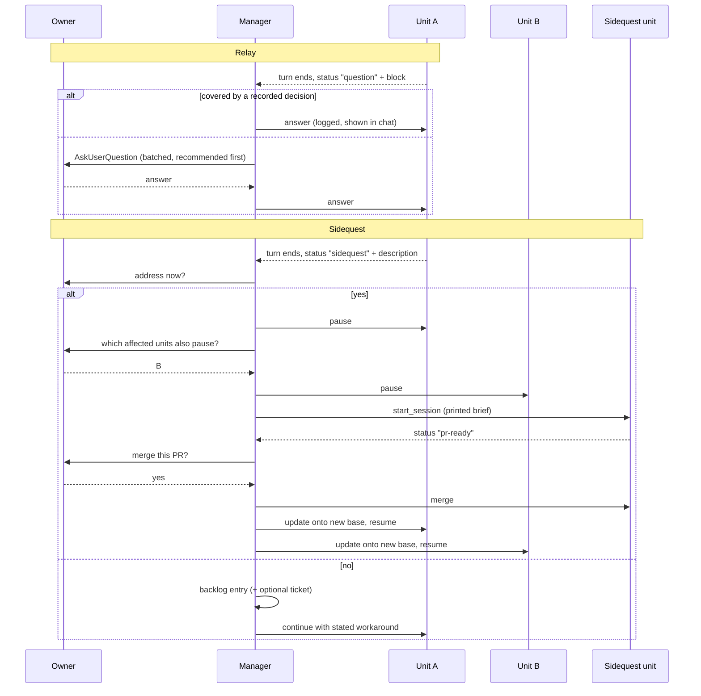

# 0008 - Agents manager

**Status:** Accepted
**Date:** 2026-11-21

## Context

One session per work unit today: the owner starts each playbook or task by hand, answers questions in each UI, orders merges and updates dependents. The Claude desktop app now offers app sessions (`mcp__ccd_session__start_session`, messages between sessions, per-session model and effort). `delegation.md` Sessions uses them for step-level sessions inside one work item only; nothing coordinates several work units.

## Decision

`/agentic-claude-agents-manager`: a main Claude desktop session (the **manager**) runs work **units** as app sessions and coordinates them.

- **Units and relay**
  - Unit = anything: playbook invocation, free-form brief, plain interactive session. Kinds: `playbook | free | sidequest | adopted` (hand-started session adopted on request).
  - Every unit question reaches the owner through the manager. A unit never prompts in its own UI: it ends its turn with a status line first (`Unit <id>: question | sidequest | pr-ready | blocked | working | done`), then the block. First, because the app's wake note is the first 400 chars of the final message.
  - `working` = unit idle only because its own background work runs: that line alone, manager stays silent, the heartbeat still tracks progress.
  - Manager asks the owner (AskUserQuestion, batched across units, unit name in each question), sends the answer back (`SendMessage` to the unit's session id).
  - Per-unit opt-out `attended`: owner talks in the unit, manager only watches.
  - Protocol text has one source: the output of `manager brief`.
- **Authority**
  - Auto-answer only from the owner's recorded decisions: launch presets, standing rules, the identical question already answered for another unit. Each one logged in `decisions.md` and shown in the manager chat. Anything else → owner, recommended answer first.
  - Merges: manager computes the order, asks per PR (green + reviewed); same question offers archiving the session after cleanup. The yes is bound to the PR head sha: the unit merges only at the sha the relayed yes names; head moved → unit reports `pr-ready` again, new yes. On yes the owning unit merges with its own tooling (playbook: `agentic.ts merge`; others: squash with head match), manager verifies, tells waiting units to update onto the new base. Conflicts: owning unit resolves; non-mechanical → owner. Manager never edits code.
  - Stale ladder: heartbeat (`manager.heartbeat`, session cron). Armed exactly while at least one unit is `running`, deleted otherwise, re-armed on resume. Each beat first reads an idle unit's last message for a status line not yet handled (the wake note may have been held, see Consequences), then compares progress markers. Rungs on unchanged markers: first beat ok, then nudge, stop + resume with recap, ask owner. Destructive moves (restart, archive, discard work) always ask. Unit waiting on a permission prompt → owner told at once with the session link.
- **Sidequests and dependencies**
  - A unit hitting a project-global problem outside its scope reports it, never fixes it. Manager asks "address now?".
  - Yes → surfacing unit pauses, owner picks which other affected units pause, sidequest unit launched. Accepted sidequest units start first, ahead of other queued units, still under the parallel cap. A unit can be paused by several sidequests: `--paused-by` appends; `resume` once every listed sidequest merged; leaving `paused` clears the list. After the PR merges each paused unit updates onto the new base and resumes.
  - No → ledger backlog (raising unit + context, optional tracker ticket), unit continues with a stated workaround. Re-offered when units finish or a second unit hits it.
  - B needs A's code, asked each time: `wait` (B's non-code phases start now, implementation held until A merges) or `stacked` (B cut from A's branch, PR retargeted after A merges). `--deps` requires `--dep-mode wait|stacked`.
- **Ledger, helper CLI, hooks**
  - `{output}/_manager/`, one per repo: `events.jsonl` (append-only, source of truth), `state.json` (derived), `decisions.md` (every answer, who, on what basis). A new manager session resumes from it. No work-item workflow is used.
  - Written only through `bun agentic.ts manager `: `start`, `unit add`, `unit set`, `brief`, `question open`, `question answer`, `rule add`, `backlog add`, `backlog set`, `beat`, `status`. Flags: helper usage. Unit id `none` is reserved.
  - Launch order: `unit add` each unit (deps first), then the launch table is shown and the owner confirms once. Edits beyond model / effort / attended: unit marked `failed` and re-added.
  - `manager` commands are refused (exit 1) from a unit's cwd, except for a unit whose path equals the manager cwd.
  - Unit matching (hooks and the refusal above): cwd inside a live unit's recorded path (`running | waiting | paused | pr`) first, then current branch against unit id (+ app hex suffix) or the recorded branch.
  - Ledger read: hooks lenient (unparseable lines skipped, read error = no ledger → allow), CLI strict (bad line → exit 1). Exception: a `Manager unit: <id>` spawn fails closed.
  - `hook spawn`: strict from the manager's cwd. A `start_session` from the recorded manager cwd needs a `Manager unit: <id>` line, or `Manager unit: none` for a session outside the ledger; else deny. `Manager unit: <id>` checks: unit in ledger, `Work item: none`, relay block verbatim, ledger model (alias-normalised) and effort; fails closed with no readable ledger or unknown unit. Fix = `manager brief <id>`. The line never disables the existing work-item checks.
  - `hook compact`: manager cwd → prints `manager status`; non-attended unit path → re-prints the protocol.
  - `hook ask` (PreToolUse `AskUserQuestion`): cwd matches a non-attended unit → deny, "end your turn with the question block".
- **Model, effort, capacity**
  - Step keys `unit` (frontier / high), `unit.sidequest` (code / high); `unit.<playbook>` falls back to `unit`. Shown in a launch table (unit, kind, model, effort, deps) the owner edits or confirms once; changeable mid-flight, applies next turn.
  - Limits read by the helper: `manager.parallel` (4, extra units queue, start as slots free, deps permitting), `manager.heartbeat` (15 min), `manager.usage` (80 %). Plan usage read at launch and each beat; at the limit → stop starting queued units, ask owner (continue / pause queue / downgrade models).
- **Workspace and teardown**
  - Each unit session gets an app-managed worktree (`use_worktree: true`, `branch_name` = unit id). Playbook units get the preset `workspace=current`.
  - After merge + the unit's own cleanup: session archived if the merge yes included it; summary kept in the ledger.

## Rationale

- One place to answer: the owner stops watching N session UIs; batching and reuse of recorded answers come for free.
- Owner keeps every irreversible call (merge, destructive recovery, scope change); the manager only carries, orders and checks.
- Same pattern as [ADR-0007](0007-helper-cli.md): bookkeeping in tested code, briefs gated by a hook.

## Alternatives Considered

- **Manager merges itself**: rejected. The owning unit merges with its own tooling (playbook: `agentic.ts merge`); the manager never edits code.
- **Manager never merges**: rejected. Merges release waiting units and resume paused ones, so the manager orders them, asks per PR and verifies.
- **Standing auto-merge**: rejected. Merge is an owner approval each time, now bound to the PR head sha.
- **Event-driven only, no heartbeat**: rejected. Nothing wakes the manager for a unit hung mid-turn or at a permission prompt; held wake notes (below) make the heartbeat the guaranteed channel.
- **Conversation-only state**: rejected. Lost on compaction or a new session; hooks read the ledger on disk.
- **Brief-only relay, no `AskUserQuestion` hook**: rejected. A pending interactive question leaves no event in work-item state: the relay protocol is the only signal.
- **Agentic-managed worktrees**: rejected. The app manages a worktree per session (`use_worktree`); playbook units use `workspace=current` instead of a second one.
- **New top-level `manager` config key**: rejected. `unit*` step keys reuse the existing step resolution and parent fallback.

## Consequences

- Claude desktop only: listed in `.claude-plugin/plugin.json` alone.
- A unit cannot start above the manager's own model / effort: manager warns, starts at the cap; raising goes through the app's approval card.
- Hooks match on cwd (then branch): a unit whose path equals the manager's cwd cannot be told apart, so `hook ask` lets it through and `manager` commands are not refused there.
- The manager must never invoke an agentic skill on a unit's slug: it would become the entry skill and ask to mark the unit's open runs `failed interrupted`. Reads only: `agentic.ts resume --work <slug>`, `state --work <slug>`, `list_events`, `get_session`, `mcp__ccd_pr__get_status`.
- Every manager brief carries `Work item: none`, else the existing `hook spawn` denies it. A non-unit session started from the manager cwd carries `Manager unit: none`.
- A unit turn woken by another session's message cannot `start_session`: its steps fall back to subagents.
- Anything enumerating work items in `{output}` must skip `_manager`.
- Wake limit seen live: after many child notes in a row with no owner message, the app holds further notes until the owner's next turn (a held `done` note arrived with the owner's next message). `working` turn-ends spend that budget, so units keep their own subagents in the foreground where possible and the heartbeat is the guaranteed channel.
- Unit matching by branch is loose (hex suffix pattern may over-match; unit id used unescaped in a pattern). Spawn check ignores unit state.

## History

| Date | Change |
|---|---|
| 2026-11-21 | Created |
| 2026-11-22 | Re-synced with the built feature: sixth status `working`; merge yes bound to head sha; strict `hook spawn` + `Manager unit: none`; `manager` refused from unit cwd; lenient hook ledger reads; unit matching; sidequests start first, `--paused-by` list; `--deps` needs `--dep-mode`; launch order; heartbeat rules; limits read by code; wake-limit consequence; alternatives reasons re-sourced |
