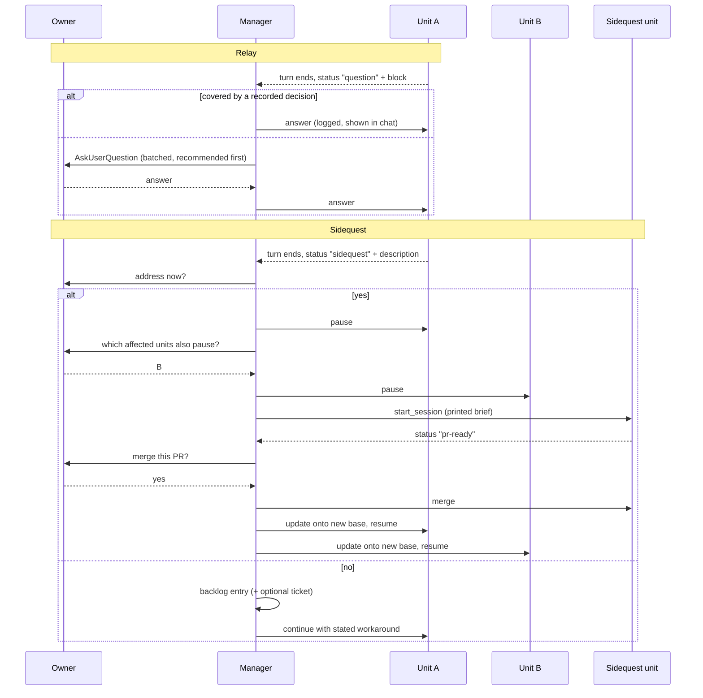

# 0008 - Agents manager

**Status:** Accepted
**Date:** 2026-11-21

## Context

One session per work unit today: the owner starts each playbook or task by hand, answers questions in each UI, orders merges and updates dependents. The Claude desktop app now offers app sessions (`mcp__ccd_session__start_session`, messages between sessions, per-session model and effort). `delegation.md` Sessions uses them for step-level sessions inside one work item only; nothing coordinates several work units.

## Decision

`/agentic-claude-agents-manager`: a main Claude desktop session (the **manager**) runs work **units** as app sessions and coordinates them.

- **Units and relay**
  - Unit = anything: playbook invocation, free-form brief, plain interactive session. Kinds: `playbook | free | sidequest | adopted` (hand-started session adopted on request).
  - Every unit question reaches the owner through the manager. A unit never prompts in its own UI: it ends its turn with a status line first (`Unit <id>: question | sidequest | pr-ready | done | blocked`), then the block. First, because the app's wake note is the first 400 chars of the final message.
  - Manager asks the owner (AskUserQuestion, batched across units, unit name in each question), sends the answer back (`SendMessage` to the unit's session id).
  - Per-unit opt-out `attended`: owner talks in the unit, manager only watches.
  - Protocol text has one source: the output of `manager brief`.
- **Authority**
  - Auto-answer only from the owner's recorded decisions: launch presets, standing rules, the identical question already answered for another unit. Each one logged in `decisions.md` and shown in the manager chat. Anything else → owner, recommended answer first.
  - Merges: manager computes the order, asks per PR (green + reviewed); same question offers archiving the session after cleanup. On yes the owning unit merges with its own tooling (playbook: `agentic.ts merge`; others: squash with head match), manager verifies, tells waiting units to update onto the new base. Conflicts: owning unit resolves; non-mechanical → owner. Manager never edits code.
  - Stale ladder: heartbeat (15 min, session cron, re-armed on resume). No transcript progress since last beat → beat 1 nudge, beat 2 stop turn + resume with recap, beat 3 ask owner. Destructive moves (restart, archive, discard work) always ask. Unit waiting on a permission prompt → owner told at once with the session link.
- **Sidequests and dependencies**
  - A unit hitting a project-global problem outside its scope reports it, never fixes it. Manager asks "address now?".
  - Yes → surfacing unit pauses, owner picks which other affected units pause, sidequest unit launched; after its PR merges each paused unit updates onto the new base and resumes.
  - No → ledger backlog (raising unit + context, optional tracker ticket), unit continues with a stated workaround. Re-offered when units finish or a second unit hits it.
  - B needs A's code, asked each time: `wait` (B's non-code phases start now, implementation held until A merges) or `stacked` (B cut from A's branch, PR retargeted after A merges).
- **Ledger, helper CLI, hooks**
  - `{output}/_manager/`, one per repo: `events.jsonl` (append-only, source of truth), `state.json` (derived), `decisions.md` (every answer, who, on what basis). A new manager session resumes from it. No work-item workflow is used.
  - Written only through `bun agentic.ts manager `: `start`, `unit add`, `unit set`, `brief`, `question open`, `question answer`, `rule add`, `backlog add`, `backlog set`, `beat`, `status`.
  - `hook spawn`: a `start_session` prompt carrying `Manager unit: <id>` must be the printed brief, with the ledger's model and effort; else deny, fix = `manager brief <id>`.
  - `hook compact`: manager cwd → prints `manager status`; non-attended unit path → re-prints the protocol.
  - `hook ask` (new, PreToolUse `AskUserQuestion`): cwd inside an active non-attended unit's path → deny, "end your turn with the question block".
- **Model, effort, capacity**
  - Step keys `unit` (frontier / high), `unit.sidequest` (code / high); `unit.<playbook>` falls back to `unit`. Shown in a launch table (unit, kind, model, effort, deps) the owner edits or confirms once; changeable mid-flight, applies next turn.
  - Limits: `manager.parallel` = 4 (extra units queue, start as slots free, deps permitting), `manager.heartbeat` = 15 min, `manager.usage` = 80 %. Plan usage read at launch and each beat; at the limit → stop starting queued units, ask owner (continue / pause queue / downgrade models).
- **Workspace and teardown**
  - Each unit session gets an app-managed worktree (`use_worktree: true`, `branch_name` = unit id). Playbook units get the preset `workspace=current`.
  - After merge + the unit's own cleanup: session archived if the merge yes included it; summary kept in the ledger.

## Rationale

- One place to answer: the owner stops watching N session UIs; batching and reuse of recorded answers come for free.
- Owner keeps every irreversible call (merge, destructive recovery, scope change); the manager only carries, orders and checks.
- Same pattern as [ADR-0007](0007-helper-cli.md): bookkeeping in tested code, briefs gated by a hook.

## Alternatives Considered

- **Relay blockers only**: rejected. The owner still has to watch every unit UI for the rest.
- **Manager merges itself**: rejected. The unit owns its merge tooling and work-item state; the manager never edits code.
- **Manager never merges**: rejected. Waiting and paused units would block on the owner merging by hand, in the right order.
- **Standing auto-merge**: rejected. A merge is irreversible: one yes per PR.
- **Event-driven only, no heartbeat**: rejected. A stalled unit never ends its turn, so nothing wakes the manager.
- **Conversation-only state**: rejected. Lost on compaction or a new session; hooks need state on disk to check against.
- **Brief-only relay, no `AskUserQuestion` hook**: rejected. A pending interactive question leaves no event: a unit that prompts anyway waits unseen.
- **Agentic-managed worktrees**: rejected. The app already gives each session a worktree; a second one per unit is duplication.
- **New top-level `manager` config key**: rejected. `unit*` step keys reuse the existing step resolution and parent fallback.

## Consequences

- Claude desktop only: listed in `.claude-plugin/plugin.json` alone.
- A unit cannot start above the manager's own model / effort: manager warns, starts at the cap; raising goes through the app's approval card.
- Hooks match on cwd: a unit whose path equals the manager's cwd cannot be told apart, so `hook ask` lets it through.
- The manager must never invoke an agentic skill on a unit's slug: it would become the entry skill and ask to mark the unit's open runs `failed interrupted`. Reads only: `agentic.ts resume --work <slug>`, `state --work <slug>`, `list_events`, `get_session`, `mcp__ccd_pr__get_status`.
- Every manager brief carries `Work item: none`, else the existing `hook spawn` denies it.
- A unit turn woken by another session's message cannot `start_session`: its steps fall back to subagents.
- Anything enumerating work items in `{output}` must skip `_manager`.

## History

| Date | Change |
|---|---|
| 2026-11-21 | Created |
